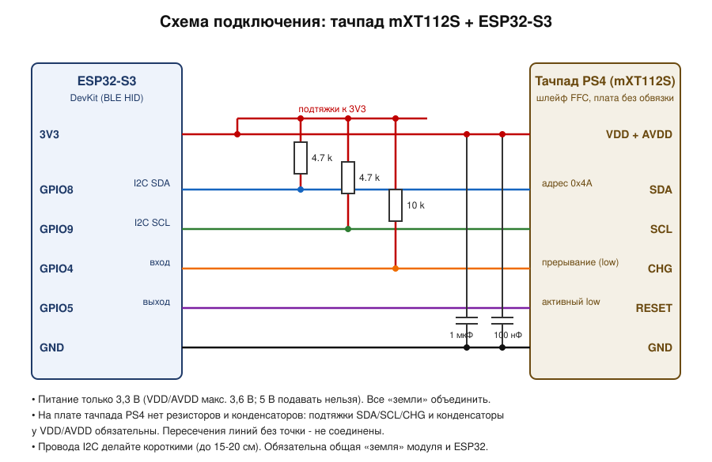
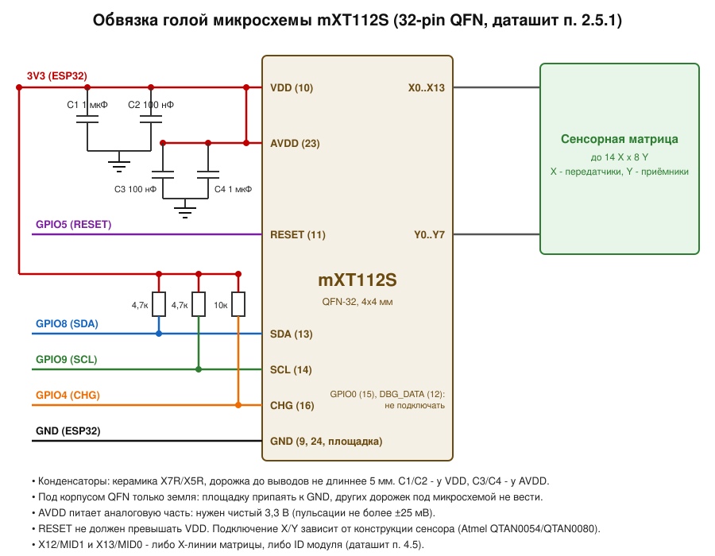

# Bluetooth-тачпад: mXT112S + ESP32-S3

Тачпад на микросхеме **Atmel/Microchip mXT112S** подключается к **ESP32-S3** по I²C.
ESP32-S3 читает касания, превращает их в жесты и отправляет на компьютер, телефон или планшет
как **Bluetooth-мышь** (BLE HID).

```
 тачпад mXT112S ──I²C + CHG──► ESP32-S3 ──BLE HID──► ПК / Android / macOS / iOS / Linux
 (до 4 касаний)                 (жесты → мышь)
```

> ESP32-S3 поддерживает только **Bluetooth LE**, классического Bluetooth в нём нет.
> Поэтому устройство работает как BLE HID (HOGP). Его понимают Windows 10/11, Android, macOS,
> iOS, ChromeOS и современный Linux. Подключать его нужно через обычное меню «Добавить устройство Bluetooth».

## Что в репозитории

| Путь | Назначение |
|---|---|
| `mxt112s_ble_touchpad/` | Скетч для Arduino IDE (открывать `mxt112s_ble_touchpad.ino`) |
| `docs/wiring.svg` | Схема подключения ESP32-S3 ↔ тачпад-модуль |
| `docs/bare_chip.svg` | Обвязка «голой» микросхемы по даташиту (конденсаторы, подтяжки) |
| `tests/` | Тесты логики на ПК (`tests/run.sh`), без железа |

Файлы скетча: `config.h` (все настройки), `mxt112s.h/.cpp` (драйвер чипа), `gestures.h` (жесты),
`ble_hid_mouse.h` (Bluetooth), `.ino` (основной цикл).

## Схема подключения



| ESP32-S3 | mXT112S | Примечание |
|---|---|---|
| 3V3 | VDD и AVDD | **только 3,3 В**, абсолютный максимум чипа 3,6 В |
| GND | GND | общая «земля» |
| GPIO8 | SDA | подтяжка 4,7 кОм к 3V3 |
| GPIO9 | SCL | подтяжка 4,7 кОм к 3V3 |
| GPIO4 | CHG | подтяжка 10 кОм к 3V3; низкий уровень = есть сообщение |
| GPIO5 | RESET | желательно подключить; не должен превышать VDD |

Пины меняются в `config.h`. Не используйте GPIO0/3/45/46 (strapping), 19/20 (USB) и 26–37 (флеш/PSRAM).

Из даташита важно для подключения:

- адрес I²C **0x4A**, частота до 400 кГц (п. 5.2, 7.10);
- питание VDD 1,8–3,3 В, AVDD 2,7–3,3 В (п. 7.2); ESP32-S3 с логикой 3,3 В подходит напрямую, преобразователь уровней не нужен;
- CHG — открытый сток, нужна подтяжка к VDD (обычно 10 кОм); после сброса около 100 мс линия работает как вход, поэтому её нельзя тянуть вниз (п. 4.1, 5.7);
- после подачи питания чип готов через ~20 мс (п. 7.9).

Если у вас **готовый модуль** (плата с разъёмом или FPC), то конденсаторы питания там обычно уже есть,
а подтяжки могут быть. Тогда внешние подтяжки можно не ставить. Если вы разводите **свою плату**, смотрите
`docs/bare_chip.svg`: по 100 нФ + 1 мкФ на VDD и AVDD (X7R/X5R, дорожка до вывода не длиннее 5 мм),
площадка QFN на GND, под корпусом никаких других дорожек.



## Прошивка (Arduino IDE)

1. Установите пакет плат **esp32 by Espressif Systems** (проверяйте на 2.0.x и 3.x) через «Менеджер плат».
2. Выберите плату **ESP32S3 Dev Module**, включите **USB CDC On Boot: Enabled** (чтобы работал `Serial`).
3. Откройте `mxt112s_ble_touchpad/mxt112s_ble_touchpad.ino`. Сторонние библиотеки не нужны:
   используются встроенные `Wire` и `BLE` из пакета esp32.
4. Прошейте и откройте монитор порта на 115200.

При старте в мониторе должно появиться примерно такое:

```
mXT: family=0x.. variant=0x.. version=0x.. build=0x.. matrix=14x8 objects=NN
  T5 ... T6 ... T7 ... T9 ...
T7 power: idle=.. ms active=.. ms ...
T9 touch: ctrl=0x.. size=.. orient=.. numtouch=.. range=XXXXxYYYY
BLE запущен, имя: ESP32 Touchpad
```

Затем на компьютере или телефоне добавьте Bluetooth-устройство **ESP32 Touchpad**.
После сопряжения курсор двигается пальцем по тачпаду.

## Жесты

| Жест | Действие |
|---|---|
| Один палец | движение курсора (с ускорением) |
| Тап одним пальцем | левый клик |
| Тап двумя пальцами | правый клик |
| Тап тремя пальцами | средний клик |
| Тап и сразу касание, затем движение | перетаскивание (левая кнопка удерживается) |
| Два пальца, движение | прокрутка (вертикальная и горизонтальная) |

Это режим **относительной мыши**, а не Windows Precision Touchpad: курсор получает смещения, как от мыши.
Зато он одинаково работает на всех системах без драйверов.

## Настройка

Всё в `config.h`:

- **Ориентация**: `TP_SWAP_XY`, `TP_INVERT_X`, `TP_INVERT_Y`. Если курсор идёт не туда, меняйте эти флаги.
  Для подбора включите `DEBUG_TOUCH 1`, и в Serial пойдут координаты пальцев.
- **Скорость**: `POINTER_PX_PER_SPAN` (пикселей за проход по длинной стороне), `POINTER_ACCEL`, `POINTER_ACCEL_MAX`.
- **Прокрутка**: `SCROLL_NOTCHES_PER_SPAN`, `SCROLL_NATURAL` (1 = как на смартфоне), `SCROLL_HORIZONTAL`.
- **Тапы**: `TAP_TO_CLICK`, `TAP_DRAG`, `TAP_MAX_MS`, `TAP_MAX_MOVE_FRAC`, `DRAG_WINDOW_MS`.
- **Конфигурация чипа**: `MXT_APPLY_SAFE_DEFAULTS` (см. ниже).

## Если не работает

| Симптом | Что проверить |
|---|---|
| `Тачпад не отвечает`, сканер I²C пуст | питание 3,3 В на VDD **и** AVDD, общая земля, SDA/SCL не перепутаны, подтяжки есть |
| Сканер показал другой адрес | модуль с другим адресом: поменяйте `MXT_I2C_ADDR` (в даташите чипа 0x4A) |
| Чип найден, касаний нет, в `T7 power` стоит `0 = deep sleep` | чип не сконфигурирован: включите `MXT_APPLY_SAFE_DEFAULTS 1` |
| `T9 ctrl ... ENABLE bit is off` | то же самое: включите `MXT_APPLY_SAFE_DEFAULTS 1` |
| `T9 not found` | в прошивке чипа нет объекта T9 (например, только T100): эта версия скетча его не поддерживает |
| Курсор идёт по другой оси или в обратную сторону | `TP_SWAP_XY` / `TP_INVERT_X` / `TP_INVERT_Y` |
| Устройство не находится или не подключается после перепрошивки | удалите «ESP32 Touchpad» в списке Bluetooth на хосте и добавьте заново |
| Курсор дрожит | проверьте чистоту питания AVDD (±25 мВ), короткие провода, общую землю |

`MXT_APPLY_SAFE_DEFAULTS` записывает в **RAM** чипа период опроса (T7) и включает T9; после отключения питания
записанное пропадает, поэтому применяется при каждом старте. Сохранение во флеш чипа (`MXT_SAVE_TO_NVM 1`)
имеет ресурс 10 000 записей (даташит, п. 7.1), включайте его только осознанно и один раз.

## Как это работает

1. ESP32 сбрасывает чип (RESET), читает блок информации и **таблицу объектов** (адреса T5, T6, T7, T9).
2. Пока линия CHG низкая, ESP32 читает сообщения из объекта T5. Сообщения T9 содержат статус и 12-битные
   координаты каждого касания, сообщения T6 — события сброса и калибровки.
3. `gestures.h` из набора касаний делает смещения, клики и прокрутку.
4. `ble_hid_mouse.h` отправляет отчёт HID-мыши (кнопки, X, Y, колесо, горизонтальная прокрутка) не чаще раза в 8 мс.

## Тесты и что проверено

`tests/run.sh` (нужен `g++`) запускает:

- модульные тесты жестов: движение, ускорение, тапы, правый и средний клики, перетаскивание, прокрутка,
  натуральная прокрутка, дрожание, разбиение больших смещений;
- сквозной тест всего скетча с **эмулятором mXT112S** (таблица объектов, report ID, CHG, очередь сообщений T5)
  и заглушкой BLE: инициализация, движение, тап, прокрутка двумя пальцами, отсутствие отправки без подключения,
  восстановление, если чип появился позже.

**Чего здесь не проверялось:** сборка самим Arduino-компилятором для ESP32-S3 (в окружении, где писался код,
не было доступа к загрузке инструментов) и работа на реальном железе. Заглушка BLE повторяет API библиотеки
Arduino-ESP32 по памяти, поэтому первая сборка в Arduino IDE может потребовать мелкой правки
(например, если в вашей версии пакета esp32 поменялась сигнатура одного из BLE-вызовов в `ble_hid_mouse.h`).
Адреса и поля объектов T5/T6/T7/T9 соответствуют общему объектному протоколу maXTouch; в даташите mXT112S
их нет (он отсылает к *mXT112S Protocol Guide*), поэтому скетч при старте печатает таблицу объектов и
значения T7/T9, чтобы вы могли сверить их с чипом.
